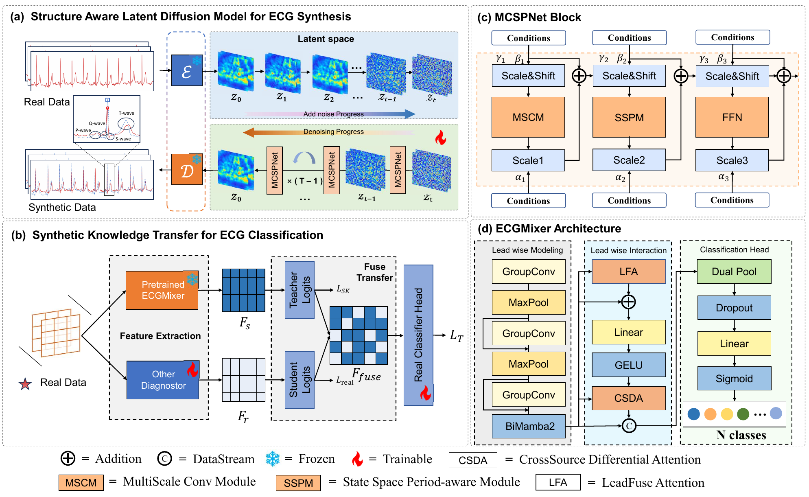
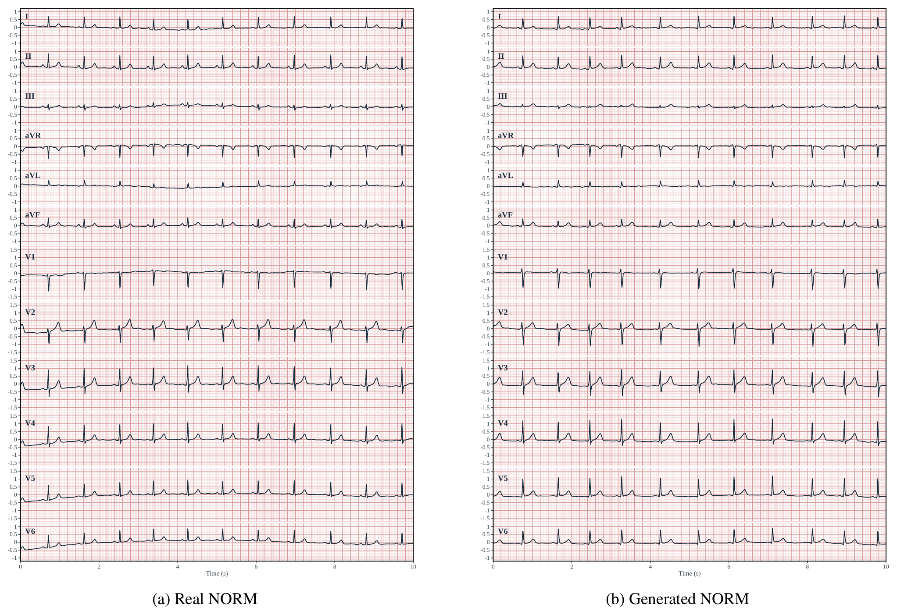

# Structure-Aware Latent Diffusion for Multi-Label ECG Synthesis with Synthetic Knowledge Transfer for Enhanced Classification

**Submitted to Information Fusion.** (The code is still being refined, but all core functionality is already in place.)

**Notes:** Trained model weights, generated data, and evaluation result files will all be made available upon acceptance of the paper.

Official PyTorch implementation of SALDM and ECGMixer for conditional multi-label ECG generation and classification.



## Setup

Linux, Python 3.10 and an NVIDIA GPU are required. CUDA extensions need a matching CUDA toolkit and C++ compiler.

```bash
python3.10 -m venv .venv
source .venv/bin/activate
python -m pip install --upgrade pip setuptools wheel packaging ninja
python -m pip install torch==2.11.0 --index-url https://download.pytorch.org/whl/cu128
python -m pip install --no-build-isolation -r requirements.txt
```

## Data

Download [PTB-XL 1.0.1](https://physionet.org/content/ptb-xl/1.0.1/) (`ptbxl_database.csv`, `records500/`), [CPSC2018](http://2018.icbeb.org/Challenge.html) (`REFERENCE.csv`, original MAT records), or [SPH](https://doi.org/10.1038/s41597-022-01403-5) (`metadata.csv`, `records/*.h5`). Run from the repository root:

```bash
python src/scripts/preprocess_ptbxl.py --raw-dir /path/to/ptb-xl
python src/scripts/preprocess_cpsc2018.py --raw-dir /path/to/CPSC2018
python src/scripts/preprocess_sph.py --raw-dir /path/to/SPH
```

Arrays are saved under `data/`: eight leads, 1,000 samples, 100 Hz. PTB-XL uses official folds; CPSC2018 and SPH use the supplied final split tables. Paths are configured in `src/configs/`.

## Training and generation

```bash
export CUDA_VISIBLE_DEVICES=0
python src/scripts/train_vae.py --run-name vae_run
python src/scripts/train_dm.py --vae-run vae_run --run-name dm_run
python src/scripts/generate_dataset.py \
  --vae-run vae_run --dm-run dm_run --run-name samples --devices cuda:0
```

Defaults: **PTB-XL, 71 labels, CFG 1.5**. For CPSC2018 or SPH, add `--config src/configs/mcspnet_cpsc2018.yaml` or `--config src/configs/mcspnet_sph.yaml` to each command. Generation saves eight leads; the standalone conversion utility is `src/scripts/utils/leads.py`. Weights are not bundled.

## Visualization

Representative 12-lead, 10-second normal (NORM) ECGs: a real test sample (left) and a SALDM-ECG-generated sample (right).



## Evaluation

Download `hubert_ecg.py`, `config.json` and `model.safetensors` from [HuBERT-ECG Base](https://huggingface.co/Edoardo-Coppola/hubert-ecg-base), then set `eval.hubert_model_dir` in the dataset configuration.

```bash
python src/scripts/eval_generation_quality.py \
  --synthetic-root outputs/generation/generate/samples/sssd_arrays \
  --output outputs/generation/evaluation/samples_test.json
```

This computes ECG-FID, ECG-MMD2, Density, Coverage, PSD-SWD and Corr-SWD. Select the matching dataset configuration when evaluating CPSC2018 or SPH.

## Classification and augmentation

```bash
python src/scripts/train_classifier.py --run-name real
python src/scripts/train_classifier.py --protocol AUGMENT --augmentation-ratio 0.25 \
  --synthetic-root outputs/generation/generate/samples/sssd_arrays --run-name augmented
```

Supported augmentation ratios: **0.15, 0.25, 0.5, 1.0**. Select data with `--dataset`; PTB-XL label spaces are `label_all` (71), `label_diag` (44), and `label_diag_superclass` (5). Each run saves weights, test metrics and predictions. Use `--seed` for individual runs; experiment seeds are listed in `src/configs/ecgmixer.yaml`.

Train a synthetic-data teacher, then transfer its knowledge to a classifier trained on real ECGs:

```bash
python src/scripts/train_classifier.py --protocol TSTS --run-name teacher \
  --synthetic-root outputs/generation/generate/samples/sssd_arrays
python src/scripts/train_classifier.py --run-name student \
  --teacher-checkpoint outputs/classification/ptbxl/label_all/teacher/checkpoints/best.pt \
  --distillation-weight 0.1 --temperature 1.0
```

The student defaults to ECGMixer. To use another classifier, pass `--student-factory your_module:factory`; the factory accepts `in_ch`, `num_classes`, `drop` and `drop_path_rate`. Cross-domain protocols `TSTS`, `TSTR` and `TRTS` are also supported.

## Ablations

```bash
python -m src.scripts.ablations.generator train --vae-run outputs/generation/vae/vae_run
python -m src.scripts.ablations.generator generate --vae-run outputs/generation/vae/vae_run
python -m src.scripts.ablations.generator evaluate
python -m src.scripts.ablations.classifier
```

Ablations default to **PTB-XL 71 classes**, with separate settings in `src/configs/ablations/`. Use `--base-config` to change the generator dataset, or `--dataset` and `--label-space` for classification. CFG, learning-rate, batch-size and distillation parameter studies are also included; see each entry point's `--help`.
